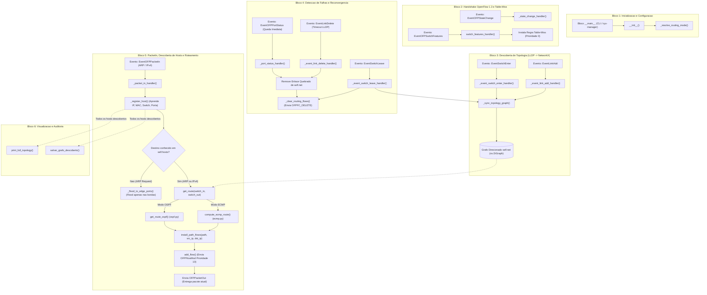

# Arquitetura e Fluxo de Funcionamento do `topo_discover.py`

Este documento descreve a arquitetura interna do controlador Ryu implementado em [`topo_discover.py`](./topo_discover.py), dividindo-o em **6 blocos funcionais** e conectando cada método/função ao seu respectivo papel no ciclo de vida OpenFlow 1.3.

---

## 1. Diagrama Mermaid da Arquitetura

---

## 2. Detalhamento de Cada Bloco e Suas Funções

### Bloco 1: Inicialização e Configuração
Responsável por subir o controlador Ryu, ler os parâmetros (`--routing ospf|ecmp`) e criar as estruturas em memória.

* **`__main__`**: Ponto de entrada quando você roda `python3 topo_discover.py --routing ospf`. Ele lê a flag `--routing`, grava o arquivo `.routing_mode` e invoca o `ryu-manager` passando `--observe-links` (necessário para o Ryu injetar pacotes LLDP).
* **`__init__(self, *args, **kwargs)`**: Construtor da classe `TopoDiscover`. Inicializa o grafo vazio `self.net = nx.DiGraph()`, os dicionários de switches (`self.datapaths`), enlaces (`self.links`), portas inter-switch (`self.switch_ports`), hosts aprendidos (`self.hosts`) e rotas já instaladas (`self.installed_paths`).
* **`_resolve_routing_mode(self)`**: Verifica qual algoritmo de roteamento (`ospf` ou `ecmp`) deve ser usado, lendo da flag de linha de comando ou do arquivo `.routing_mode` sincronizado pelo Mininet.

---

### Bloco 2: Handshake OpenFlow 1.3 e Table-Miss
Atua assim que um switch Open vSwitch do Mininet se conecta ao controlador na porta 6633.

* **`_state_change_handler(self, ev)`**: Escuta o evento `EventOFPStateChange`. Quando um switch entra no estado ativo (`MAIN_DISPATCHER`), guarda a referência dele em `self.datapaths[dpid]` para podermos enviar comandos OpenFlow a ele; quando desconecta (`DEAD_DISPATCHER`), remove-o.
* **`switch_features_handler(self, ev)`**: Escuta `EventOFPSwitchFeatures` na negociação inicial (`CONFIG_DISPATCHER`). Instala a regra **Table-Miss** (prioridade `0`, match vazio), que diz ao switch: *"qualquer pacote que não casar com nenhuma regra específica deve ser enviado ao controlador via `PacketIn`"*.

---

### Bloco 3: Descoberta de Topologia (LLDP $\to$ NetworkX)
Constrói e mantém o grafo direcionado `self.net` em tempo de execução à medida que os switches trocam pacotes LLDP.

* **`_event_switch_enter_handler(self, ev)`**: Disparado por `EventSwitchEnter` quando um novo switch é descoberto. Chama `_sync_topology_graph()`.
* **`_event_link_add_handler(self, ev)`**: Disparado por `EventLinkAdd` quando o LLDP detecta um cabo ligando dois switches. Chama `_sync_topology_graph()`.
* **`_sync_topology_graph(self)`**: É o "coração" do mapeamento da rede. Consulta `get_switch()` e `get_link()` da API do Ryu, registra quais portas são inter-switch (`self.switch_ports`) e reconstrói o grafo direcionado `self.net` (`nx.DiGraph`), guardando em cada aresta `(u, v)` o número da porta de saída (`src_port`).

---

### Bloco 4: Detecção de Falhas e Reconvergência
Garante que, se um enlace ou switch cair, o grafo seja atualizado e as regras antigas nos switches sejam apagadas imediatamente.

* **`_port_status_handler(self, ev)`**: Escuta `EventOFPPortStatus` (OpenFlow 1.3 nativo). Assim que ocorre uma queda de porta (ex.: `link s4 s5 down`), o switch avisa imediatamente este método. Ele verifica os bits `OFPPS_LINK_DOWN` / `OFPPC_PORT_DOWN`, descobre no grafo qual switch vizinho estava conectado àquela porta, remove as arestas `(dpid, vizinho)` e `(vizinho, dpid)` do `self.net` e chama `_clear_routing_flows()`.
* **`_event_link_delete_handler(self, ev)`** e **`_event_switch_leave_handler(self, ev)`**: Eventos da camada LLDP para remoção de enlace ou saída de switch, atuando como fallback complementar ao `PortStatus`.
* **`_clear_routing_flows(self)`**: Percorre todos os switches ativos e envia uma mensagem `OFPFlowMod` com o comando **`OFPFC_DELETE`** filtrando pelo cookie `ROUTING_COOKIE (0x100)`. Isso limpa todas as rotas aprendidas anteriormente sem apagar a regra *Table-Miss* (que não usa esse cookie), forçando os próximos pacotes a subirem ao controlador para recálculo da nova rota.

---

### Bloco 5: `PacketIn`, Descoberta de Hosts e Roteamento (OSPF / ECMP)
Atua quando um pacote (ARP ou IPv4/Ping/Iperf) bate na regra *Table-Miss* de um switch e sobe para o controlador.

* **`_packet_in_handler(self, ev)`**: Orquestra todo o processamento de pacotes desconhecidos:
  1. Ignora pacotes LLDP e IPv6.
  2. Se for ARP ou IPv4, chama `_register_host()` para aprender onde está o host de origem.
  3. Se o IP de destino ainda não estiver em `self.hosts`, chama `_flood_to_edge_ports()`.
  4. Se origem e destino forem conhecidos, chama `get_route()`, instala o caminho com `install_path_flows()` e despacha o pacote atual via `OFPPacketOut`.
* **`_register_host(self, src_ip, src_mac, dpid, in_port)`**: Verifica se a porta por onde o pacote entrou **não** é uma porta entre switches (`self.switch_ports`). Se for uma porta de borda, salva `self.hosts[src_ip] = {'mac': ..., 'dpid': ..., 'port': ...}`.
* **`_flood_to_edge_ports(self, msg)`**: Em topologias com loops (como Torus e Spine-Leaf), fazer flood normal causaria *broadcast storm*. Este método envia o pacote ARP Request **apenas para as portas de borda (hosts)** de cada switch, nunca para portas inter-switch.
* **`get_route(self, switch_in, switch_out)`**: Chama `get_route_ospf` (menor caminho único via `nx.shortest_path` em `ospf.py`) ou `compute_ecmp_route` (múltiplos menores caminhos via `nx.all_shortest_paths` + função de hash em `ecmp.py`) sobre o grafo `self.net`.
* **`install_path_flows(self, path, src_ip, dst_ip)`**: Recebe a lista de switches do caminho (ex.: `[4, 1, 2, 5]`) e percorre **de trás para frente** (do último switch até o primeiro), descobrindo a porta de saída em cada salto e chamando `add_flow()` para instalar regras para IPv4 e ARP entre `(src_ip, dst_ip)`.
* **`add_flow(self, datapath, priority, match, actions, ...)`**: Monta e envia a mensagem `OFPFlowMod` (OpenFlow 1.3) com `priority=10` e `cookie=0x100` para o switch programar sua tabela de encaminhamento.

---

### Bloco 6: Visualização e Auditoria
* **`print_full_topology(self)`**: Imprime no terminal a lista formatada de todos os switches ativos, enlaces bidirecionais e hosts descobertos assim que todos os hosts enviam o *Gratuitous ARP*.
* **`salvar_grafo_descoberto(self, nome_arquivo=None)`**: Usa `matplotlib` e `networkx` para desenhar e salvar a imagem `.png` da topologia real descoberta pelo controlador.
