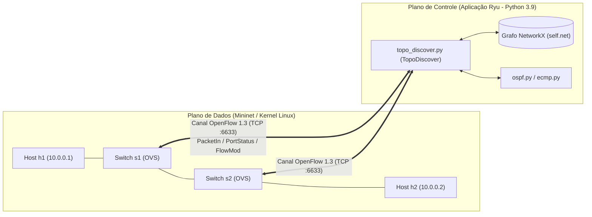
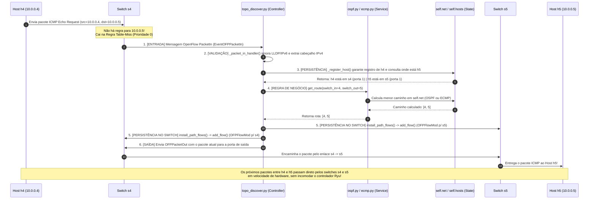

# Guia de Entendimento do Projeto SDN (Ryu + Mininet + NetworkX)

Este documento aplica a metodologia de engenharia de software em **4 etapas** para mapear e compreender de ponta a ponta o funcionamento deste projeto de Redes Definidas por Software (SDN).

---

## 1. Visão Macro: Estrutura Geral do Projeto

### 1.1 Contexto e Arquitetura (Plano de Controle vs. Plano de Dados)
Diferente de uma aplicação Web tradicional (Front-end $\leftrightarrow$ API $\leftrightarrow$ Banco de Dados), um sistema SDN é dividido em **dois processos independentes** que conversam via rede na porta TCP `6633` usando o protocolo **OpenFlow 1.3**:

1. **Plano de Controle (Controlador Ryu):** É o "cérebro" centralizado (`topo_discover.py`). Roda em espaço de usuário, mantém o grafo da rede na memória (`NetworkX`), calcula rotas (`ospf.py` / `ecmp.py`) e envia regras para os switches.
2. **Plano de Dados (Emulador Mininet + Open vSwitch):** É o "corpo" físico/emulado da rede (`fctmain.py` e `topologies.py`). Cria hosts virtuais (`h1..h9`) e switches OpenFlow (`s1..s9`) no kernel do Linux.



---

### 1.2 Árvore de Diretórios e Papel de Cada Arquivo

O projeto utiliza uma **arquitetura modular por responsabilidade** na raiz do repositório:

```text
Tarefa-2-SDN/
├── descricao.md                  # Especificação acadêmica do trabalho (Parte 2 e Parte 1)
├── README.md                     # Instruções rápidas de instalação e uso
├── arquitetura_topo_discover.md  # Diagrama detalhado dos métodos internos do controlador
├── guia_entendimento_projeto.md  # Este guia de engenharia reversa do projeto
│
├── --- PLANO DE CONTROLE (RYU) ---
├── topo_discover.py              # [CORE] Controlador SDN: eventos OpenFlow, grafo e instalação de fluxos
├── ospf.py                       # [REGRA DE NEGÓCIO] Cálculo de rota pelo menor caminho único (OSPF)
├── ecmp.py                       # [REGRA DE NEGÓCIO] Cálculo de múltiplos menores caminhos + hash (ECMP)
│
├── --- PLANO DE DADOS (MININET) ---
├── fctmain.py                    # [ORQUESTRADOR] Cria a rede no Mininet, desabilita IPv6, roda pingAll e CLI
├── topologies.py                 # [MODELOS DE REDE] Classes das topologias Torus 3x3, Spine-Leaf e Lista de Arestas
├── topologia.py                  # Script legado da Parte 1 para instanciar arquivos .txt simples
├── topo_*.txt                    # Arquivos estáticos de listas de arestas (torus, spineleaf, triangle, etc.)
│
└── --- INFRAESTRUTURA E AUTOMAÇÃO ---
    ├── install.sh                # Instala Open vSwitch, Mininet, Python 3.9 (via uv) e pacotes da .venv
    ├── requirements.txt          # Dependências Python do controlador
    └── run_test_battery.sh       # Script de bateria de testes automatizados (sobe Ryu + Mininet em background)
```

---

### 1.3 Inspeção de Dependências (`requirements.txt` e `install.sh`)

Ao abrir o `requirements.txt` e o `install.sh`, descobrimos as tecnologias que sustentam o projeto:

| Camada | Pacote / Ferramenta | Versão | Papel no Projeto |
| :--- | :--- | :--- | :--- |
| **Framework SDN** | `ryu` | `4.34` | Framework controlador OpenFlow 1.3 orientado a eventos. *(Exige Python $\le$ 3.9, configurado via `uv` no `install.sh`)*. |
| **Concorrência** | `eventlet` | `0.30.2` | Biblioteca de *green threads* usada pelo Ryu para escutar múltiplos switches de forma assíncrona. |
| **Motor de Grafos** | `networkx` | `2.8.8` | Banco de dados em memória em formato de grafo (`nx.DiGraph`) e algoritmos de caminho mínimo (`shortest_path`). |
| **Visualização** | `matplotlib` | `3.7.5` | Renderiza e exporta a fotografia da topologia descoberta em `.png`. |
| **Emulação Linux** | `mininet` + `openvswitch` | Sistema (`apt`) | Cria namespaces de rede isolados para os hosts e switches virtuais OpenFlow no Linux. |

---

## 2. Pontos de Entrada (Entry Points)

Como o sistema é composto por dois lados (Controlador e Emulador), existem **dois pontos de entrada principais** via terminal (CLI), além dos **"Endpoints de Eventos"** dentro do controlador.

### 2.1 Ponto de Entrada 1: O Controlador (`topo_discover.py`)
* **Onde nasce:** Bloco `if __name__ == '__main__':` nas linhas `645–676` de `topo_discover.py` (ou nos wrappers `ospf.py` e `ecmp.py`).
* **O que faz ao iniciar:** Lê a flag `--routing {ospf,ecmp}`, salva o modo escolhido no arquivo `.routing_mode` e invoca o gerenciador `ryu-manager` com `--observe-links`, que instancia a classe `TopoDiscover`.

### 2.2 Ponto de Entrada 2: O Emulador de Rede (`fctmain.py`)
* **Onde nasce:** Bloco `if __name__ == "__main__":` nas linhas `140–149` de `fctmain.py`.
* **O que faz ao iniciar:** Lê `--topology {torus,spineleaf}` e `--routing {ospf,ecmp}` via `parse_args()` e chama `run_network()`, que constrói os switches/hosts no Mininet e conecta todos ao controlador na porta `6633`.

### 2.3 Os "Endpoints" do Controlador (Decoradores `@set_ev_cls`)
Em uma API Web, você procura rotas como `@app.get("/users")`. No Ryu, o equivalente às rotas são os **decoradores `@set_ev_cls(...)`** em `topo_discover.py`. Eles definem exatamente a quais eventos da rede o controlador reage:

| "Endpoint" (Evento Recebido) | Método Responsável (`topo_discover.py`) | Quando é Disparado? |
| :--- | :--- | :--- |
| `EventOFPSwitchFeatures` | `switch_features_handler()` | Assim que um switch se conecta ao controlador (instala a regra *Table-Miss*). |
| `EventSwitchEnter` / `EventLinkAdd` | `_event_switch_enter_handler()` / `_event_link_add_handler()` | Quando o Ryu descobre um novo switch ou cabo via pacotes LLDP. |
| `EventOFPPortStatus` | `_port_status_handler()` | **Imediatamente** quando uma porta de switch cai (`link down`) ou sobe (`link up`). |
| `EventLinkDelete` / `EventSwitchLeave` | `_event_link_delete_handler()` / `_event_switch_leave_handler()` | Quando um enlace ou switch cai por timeout de LLDP. |
| `EventOFPPacketIn` | `_packet_in_handler()` | **Rota Principal:** Toda vez que um pacote desconhecido (ARP ou Ping/Iperf) chega a um switch sem regra instalada. |

---

## 3. Rastreando um Fluxo Completo de Ponta a Ponta

Vamos seguir o caminho completo do dado para a funcionalidade mais importante do sistema:
> **Cenário:** Na topologia Torus 3x3, o **Host `h4` (`10.0.0.4`)** envia o primeiro pacote de **Ping** para o **Host `h5` (`10.0.0.5`)**.



### Passo a Passo no Código:

1. **Entrada (`_packet_in_handler` — linha 454 de `topo_discover.py`):**
   * O switch `s4` não sabe para onde mandar o pacote destinado a `10.0.0.5`, então aplica a regra *Table-Miss* e encapsula o pacote em um evento `EventOFPPacketIn` enviado ao Ryu.
2. **Validação e Filtro (`linhas 460–504` de `topo_discover.py`):**
   * O método faz o *parsing* dos protocolos (`ethernet`, `arp`, `ipv4`).
   * Filtra ruídos: se for pacote `LLDP` ou `IPv6`, descarta imediatamente (`return`).
   * Verifica se é uma porta válida de borda em `_register_host()` (impedindo que portas entre switches sejam confundidas com portas de hosts).
3. **Regra de Negócio (`get_route` — linha 316 de `topo_discover.py`):**
   * O controlador descobre que `10.0.0.4` mora no switch `4` (`switch_in = 4`) e `10.0.0.5` mora no switch `5` (`switch_out = 5`).
   * Chama `self.get_route(4, 5)`, que delega para:
     * **`ospf.py` (`get_route_ospf`):** Chama `nx.shortest_path(self.net, 4, 5)` e devolve `[4, 5]`.
     * **Ou `ecmp.py` (`compute_ecmp_route`):** Chama `nx.all_shortest_paths(self.net, 4, 5)` e aplica o hash em `get_route_ecmp()` para sortear um dos caminhos empatados.
4. **Persistência (`install_path_flows` e `add_flow` — linhas 332–381 de `topo_discover.py`):**
   * **Na memória do controlador:** Salva a tupla do caminho em `self.installed_paths[('10.0.0.4', '10.0.0.5')] = (4, 5)`.
   * **Nas tabelas dos switches:** Percorre a lista `[4, 5]` de trás para frente (`s5` depois `s4`) enviando mensagens `OFPFlowMod` (prioridade 10, cookie `0x100`) que gravam a regra na memória de cada switch Open vSwitch.
5. **Saída (`OFPPacketOut` — linhas 533–555 de `topo_discover.py`):**
   * Para que o primeiro pacote que originou a consulta não seja perdido, o controlador envia uma ordem `OFPPacketOut` instruindo o switch a despachar imediatamente aquele pacote específico pela porta calculada.

---

## 4. Usando as Ferramentas a Seu Favor (Execução, Debug e Testes)

### 4.1 Como Rodar o Projeto Localmente (2 Terminais)
Para ver os dois processos conversando ao vivo:

* **Terminal 1 (Subir o Plano de Controle — Ryu):**
  ```bash
  source .venv/bin/activate
  python3 topo_discover.py --routing ospf
  ```
* **Terminal 2 (Subir o Plano de Dados — Mininet):**
  ```bash
  sudo python3 fctmain.py --topology torus --routing ospf
  ```

---

### 4.2 Como Depurar (Debug Manual e Inspeção de Estado)

Em projetos SDN com Mininet e Ryu, além de usar logs/breakpoints em Python, você pode **inspecionar o estado real dos switches em tempo de execução** pelo prompt `mininet>`:

1. **Ver o "Banco de Dados" de Regras instaladas em um Switch:**
   No terminal `mininet>`, digite:
   ```text
   mininet> s4 dpctl dump-flows -O OpenFlow13
   ```
   *O que você verá:* Todas as regras gravadas pelo método `add_flow()`, com `cookie=0x100`, `priority=10`, `nw_src`, `nw_dst` e a porta de saída `actions=output:X`.

2. **Rastrear um Caminho Passo a Passo com Falha Induzida:**
   No prompt `mininet>`, execute:
   ```text
   mininet> h4 ping -c 1 h5
   mininet> s4 dpctl dump-flows -O OpenFlow13
   mininet> link s4 s5 down
   mininet> s4 dpctl dump-flows -O OpenFlow13
   ```
   *O que você comprova com isso:*
   * Antes do `link s4 s5 down`, a tabela do switch `s4` tinha as regras com `cookie=0x100`.
   * No exato instante do `link s4 s5 down`, o `_port_status_handler()` roda no Ryu e dispara `_clear_routing_flows()`. Ao rodar `dump-flows` de novo, você verá que **todas as regras `cookie=0x100` sumiram** (restou apenas a regra *Table-Miss* de prioridade `0`).
   * Quando você rodar `h4 ping -c 1 h5` novamente, verá no terminal do Ryu a nova rota desviando de `s4 -> s5` (por exemplo: `s4 -> s1 -> s2 -> s5`) sendo gravada!

3. **Colocando `breakpoint()` ou Logs Detalhados no Ryu:**
   * Como o Ryu usa `eventlet` e tem timeouts de heartbeat com os switches, pausar a execução por muitos segundos num `pdb.set_trace()` pode fazer o switch achar que o controlador travou.
   * Por isso, a melhor técnica de debug no Ryu é adicionar `self.logger.info(...)` nos pontos-chave (como dentro de `_packet_in_handler` e `_port_status_handler`) para inspecionar o conteúdo de `self.net.edges(data=True)`, `self.hosts` e `self.installed_paths` em tempo real.

---

### 4.3 Lendo a Automação de Testes (`run_test_battery.sh`)
O arquivo `run_test_battery.sh` funciona como um **teste de integração de ponta a ponta**:
1. Faz um loop combinando as topologias (`torus`, `spineleaf`) e os algoritmos (`ospf`, `ecmp`).
2. Limpa sujeiras anteriores do Mininet com `sudo mn -c`.
3. Sobe o `topo_discover.py` em background (`&`), redirecionando toda a saída para `logs/ryu_<topo>_<algo>.log`.
4. Roda o `fctmain.py --batch` (que instancia a rede, envia os *Gratuitous ARPs*, executa `net.pingAll()` para testar 100% dos pares de hosts e fecha sozinho).
5. Mata o processo do Ryu e salva a imagem `.png` da topologia descoberta (`topologia_<topo>_<algo>_descoberta.png`).
